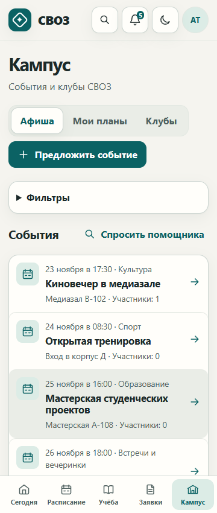
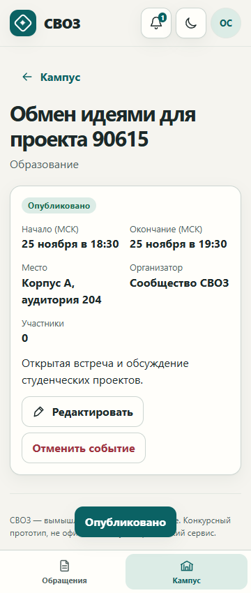
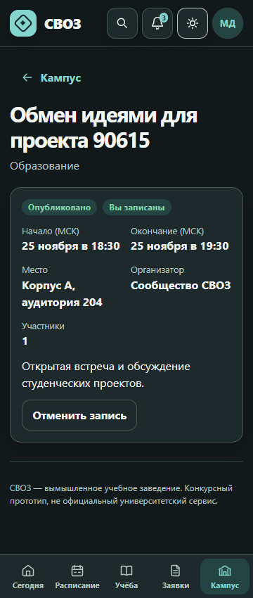
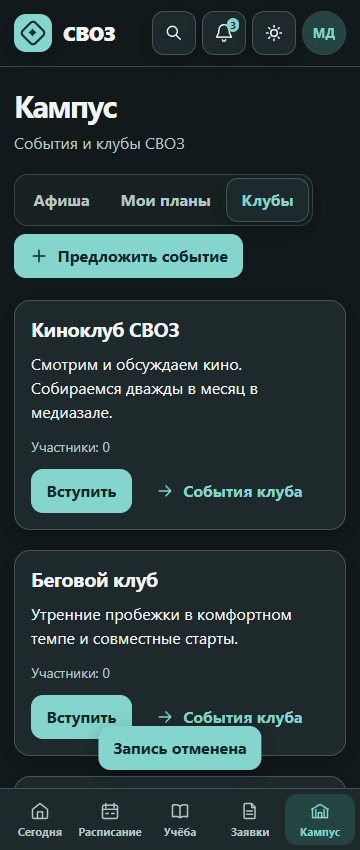

# Кампус · разработка и модерация

**Что добавили.** События и студенческие клубы получили отдельный раздел. Запись из афиши попадает в личный план. Студент может предложить встречу, деканат рассматривает предложение, публикует событие и уведомляет автора. Участник получает уведомления об изменении и отмене.

**Работа с ИИ.** Владелец попросил «добавить в существующий СВОЗ полноценный раздел внеучебной жизни». Codex отдельно поручил агентам серверные права и данные, интерфейс в существующей дизайн-системе и независимые проверки. Первые тесты получили 404 на ещё отсутствовавших маршрутах. После реализации прошли модерация, официальные события и изоляция. Первый мобильный снимок показал, что фильтры закрывали афишу. Их свернули, чтобы первую карточку можно было увидеть сразу.

# Кампус · проверка публичного стенда

**Реальный прогон.** Студент предложил мероприятие, сотрудник его опубликовал, второй студент записался и увидел запись после перезагрузки. Проверены отказ, уведомление автору, клубы, официальное событие, его изменение и отмена. Также проверены расписание, оценки, заметки, задачи и переписка с деканатом.

**Данные и ИИ.** Старая тестовая сессия стала недействительной. После входа прежние заметка, задача, сообщение, статус и отметки чтения отсутствовали, три аккаунта открылись с исходными данными. С согласия студента реальный ответ Polza показал два события без известных пересечений и назвал пару, конфликтующую с открытой тренировкой. В первом ответе была противоречивая фраза о пустом расписании. Уточняющий запрос прошёл без неё. Отдельная проверка доступности из РФ без VPN не проводилась.

