# СВОЗ · цифровой деканат будущего

Конкурсный прототип личного кабинета Современного Вайбоградского Обучающего Заведения. Все профили, оценки, расписания и правила в демо вымышлены.

## Какую проблему решает СВОЗ

Студенту приходится сверять расписание, оценки, сроки и новости в разных местах, а после подачи заявления трудно понять, кто им занимается. В СВОЗ стартовый экран «Сегодня» показывает ближайшее занятие, важные изменения и открытые дела. Расписание и учебный навигатор связывают информацию с действиями, а карточка обращения показывает статус и переписку с деканатом. Вход, профиль, расписание, успеваемость, заявки и уведомления составляют конкурсное ядро.

Исходное исследование сравнивало университетские кабинеты и практики интерфейсов. Проведение интервью и проверка продукта реальными студентами в материалах этой разработки не зафиксированы.

## Три сценария для демонстрации

- **Изменилось занятие.** Студент открывает уведомление, сравнивает старое и новое время или аудиторию и переходит к паре.
- **Скоро сдавать.** В навигаторе видна открытая учебная работа и её срок. Студент может добавить личную задачу или заметку, связанную с предметом или парой.
- **Нужна справка.** Студент выбирает услугу, проверяет текст и отправляет заявку. Сотрудник открывает её, меняет статус и отвечает. Уведомление возвращает студента в ту же переписку.

## Работа с ИИ

Владелец передал подробное задание и утвердил продуктовые решения v2. Codex изучил это задание, два исследования и два визуальных референса. Один агент собрал сервер и данные, второй подготовил интерфейс, третий провёл независимое ревью. Главный агент согласовал соединение интерфейса с сервером, готовил проверки, инструкции и конкурсный комплект.

Исходный запрос сохранён в [prompt-owner.md](prompt-owner.md). Реальные задания агентам, хронология и результаты итераций приведены в [process.md](process.md). Для браузерных проверок и снимков использованы Playwright и Chromium. PDF собран локально через ReportLab. Изображения-референсы служили ориентиром для формы полей, теней и поверхностей. В поставку интерфейса они не вошли.

## Как хранятся и защищаются данные

Пароли хранятся в SQLite в виде стойких хешей с солью. После входа браузер получает cookie с идентификатором сессии. Сервер сверяет аккаунт и роль для каждого запроса, а при обращении к записи проверяет владельца или назначенного сотрудника. Студент видит лишь свои записи. Сотруднику доступна очередь назначенных ему обращений. Изменения статуса, переписка, прочтение уведомлений и личные записи сохраняются в базе.

Помощник включается только по явному согласию. Контекст на сервере формируется из данных вошедшего студента и вымышленной справочной базы. Ключ провайдера хранится в окружении сервера. Предложенные заметки и задачи сохраняются по отдельному подтверждению. Черновик нового заявления открывается в обычной форме. Сообщение в существующей заявке отправляется по отдельному подтверждению с показом текста и номера заявки.

## Ручные шаги и публикация

Владелец выбрал направление, передал референсы и подготовил исходный конкурсный промпт. Разработка и доступные проверки выполнялись с помощью Codex. Стенд опубликован по адресу https://svoz.evgfactory.ru/. Владелец добавил DNS и выполнил установку с административными правами в своём терминале. Codex подтвердил сертификат и работу публичных сценариев. Доступность из РФ без VPN отдельно не проверялась. Локальный запуск, демонстрационные логины и шаги публикации описаны в README.
## Проверки и исправления

Шесть автоматических тестов прошли на отдельной SQLite. Проверены все три входа, изоляция заявок и записей прямыми HTTP-запросами, защита запросов от другого сайта, сохранение заметок и задач, адресные напоминания и цикл обращения. Тест ИИ использовал контролируемый ответ вместо обращения к внешней модели. Он проверил, что чужая сессия не может подтвердить предложение, один черновик нельзя сохранить дважды, а отключение ИИ отзывает предложение. HTTP 503 при проверке обращения без провайдера был ожидаемым.

В Chromium пройдены три входа, недельное расписание, перенос, сохранение заметки и задачи после обновления, заявка, ответ сотрудника и переход из уведомления. Проверены ширины 360, 390 и 768 px, две темы, клавиатурная ссылка «К содержанию», обычный поиск и переключение согласия на ИИ. В этом прогоне не обнаружено неожиданных ошибок запросов или ошибок JavaScript.

Во время первого прогона лента студента оставалась устаревшей после ответа сотрудника. В уточнении агенту было предложено обновлять данные при открытии уведомлений. После исправления повторный прогон подтвердил, что новый ответ появляется при переходе к ленте. При быстрой смене статуса перерисовка могла сбросить незавершённый ответ сотрудника. В финальной версии операции выполняются по очереди, а набранный ответ сохраняется при обновлении статуса. Также поправлены видимость фокуса и рамок полей, ссылки из напоминаний и учёт незавершённых дел в учебном навигаторе.

## Подключение Polza AI

Для внешнего помощника выбраны указанные владельцем Polza AI и DeepSeek V4.1 Flash. OpenAI-совместимый API позволил сохранить существующий сервер без новых библиотек. Нативный вызов функции проверен на действующей модели. Он возвращает ответ и предложение, а права, проверку и сохранение выполняет сервер СВОЗ. Если провайдер отклоняет параметры функции, сервер может один раз повторить запрос в формате JSON.

После явного согласия студент передаёт только данные, относящиеся к вопросу. Например, вопрос о завтрашнем расписании использует пары за завтра. Сотрудник работает с открытой назначенной заявкой и вымышленными правилами. Текст ответа сотрудника можно отредактировать в привычной форме. Статус и отправка всегда контролируются сотрудником. История диалога доступна до перезагрузки, выхода или отключения ИИ.

Реальные ответы проверены по расписанию, оценкам и вымышленным правилам. Проверены запись заметки и задачи, отправка сообщения после подтверждения, а также черновик ответа, краткая сводка, список уточнений и подсказка по правилам. В Chromium подтверждена заметка в тёмной теме на 360 px и вставка черновика сотрудником в светлой теме на 768 px. Модель вернула нативные вызовы. За ответы, по которым сохранился счётчик, Polza указала 22 012 токенов и 0,94863311 ₽. Отдельный ранний браузерный повтор не вошёл в замер.

Кроме реальных проверок прошли 15 серверных тестов. Подменённый провайдер использован для проверки фильтрации данных, отказа без согласия, отсутствия записи до подтверждения, отмены, защиты от повторной отправки, лимитов и ошибок API. Результаты этого прогона отделены от живого вызова модели.

## Изоляция посетителей публичного стенда

В публичной конфигурации после первого входа в профиле браузера создаётся отдельная SQLite с исходными вымышленными записями. Повторный вход под другой ролью в том же профиле сохраняет демонстрационный цикл. Другой браузер с тем же логином получает собственный стенд. Тест через HTTP проверил, что заявка, статус и ответ остаются в стенде создавшего их посетителя. Для начала с чистыми данными можно открыть новый приватный профиль браузера.

## Снимки браузерных проверок

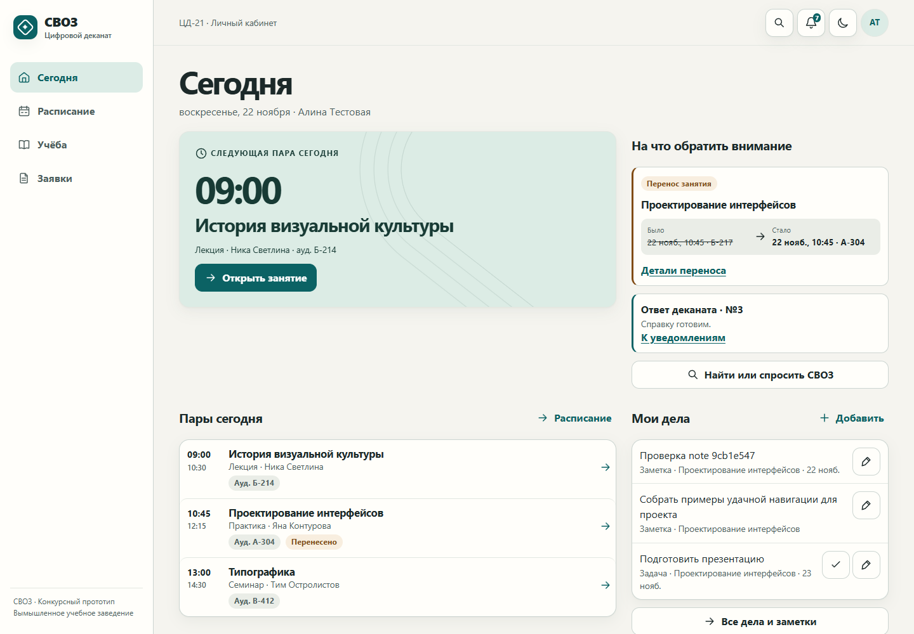

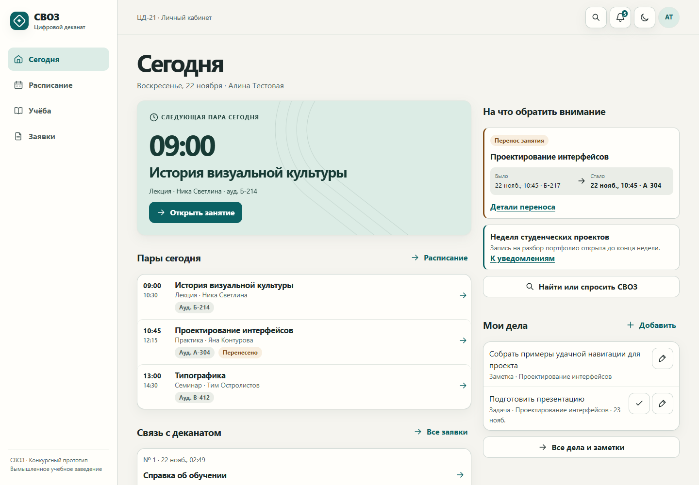

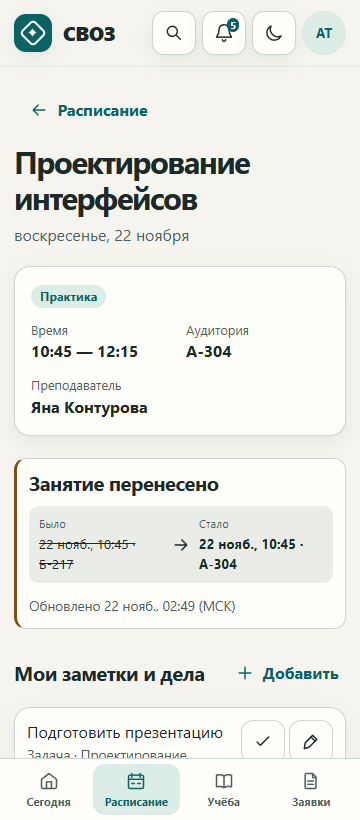

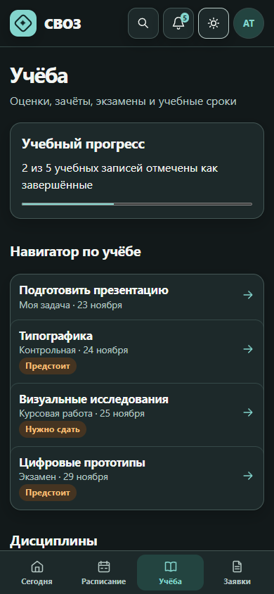


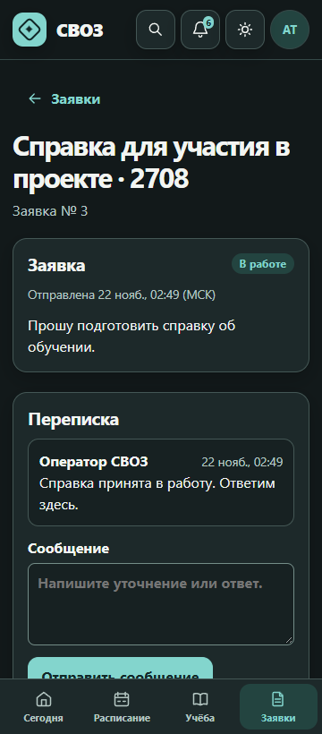

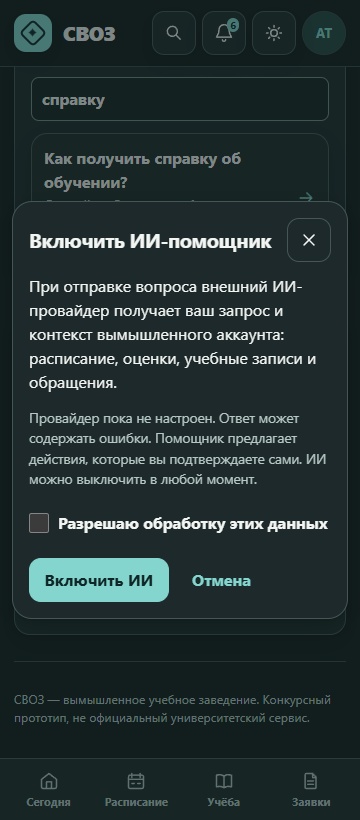

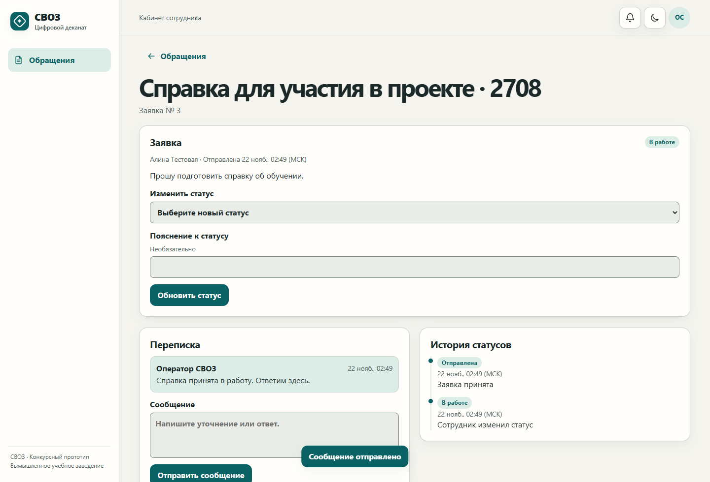


## Снимки Polza AI

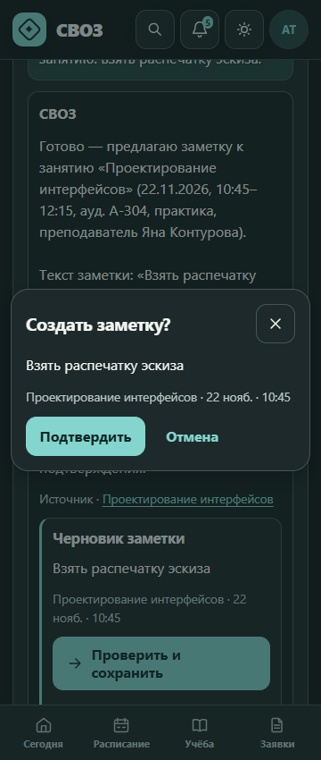

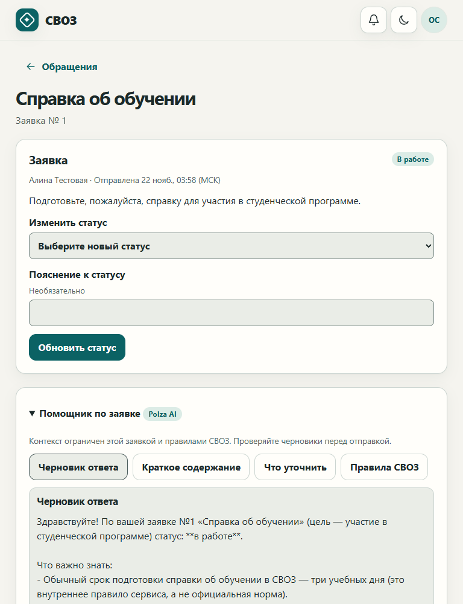


## Публичный стенд

Caddy принимает HTTPS для своего поддомена и проксирует запросы к отдельному сервису на localhost. Приложение использует закрытый постоянный каталог SQLite и включено в автозапуск. Из внешней сети проверены сертификат, вход под тремя ролями, изоляция студенческих записей и посетителей, заметки, задачи, уведомления и обработка заявки. Polza вернула реальный вызов функции. СВОЗ записал предложенную заметку только после подтверждения. После отключения ИИ кабинет продолжал работать. Служебные файлы и внутренний маршрут проверки состояния возвращают 404 снаружи. После перезапуска сервиса с прежним каталогом SQLite сессия и подтверждённая ИИ-заметка сохранились. Это проверено через публичный HTTPS.

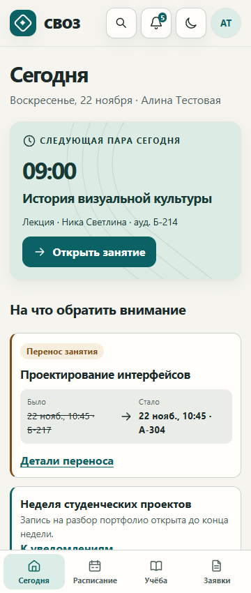

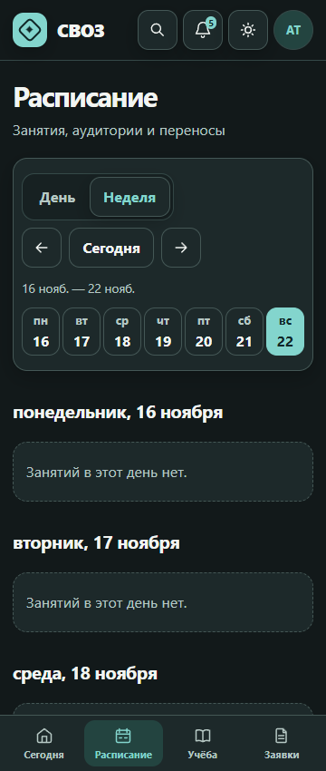


## Приложение о работе с ИИ

[Промпты, диалоги и проверенные исправления](ai-evidence.md) включены в последние две страницы PDF. Исходные материалы и история доступны в [хронологии](process.md).

PDF сохраняет девять вручную исправленных страниц. Скрипт добавляет приложение к указанному PDF и требует новый выходной файл. Для повторной сборки установите pypdf и ReportLab, затем из корня репозитория выполните:

```sh
python contest/render_report.py --base contest/report.pdf --output report-review.pdf
```

Если Arial установлен в другом каталоге, укажите его через `SVOZ_REPORT_FONTS`.

[Отдельное дополнение об обновлении «Кампус»](campus.md) содержит сценарий для жюри, этапы работы с ИИ, статус проверок и снимки.
